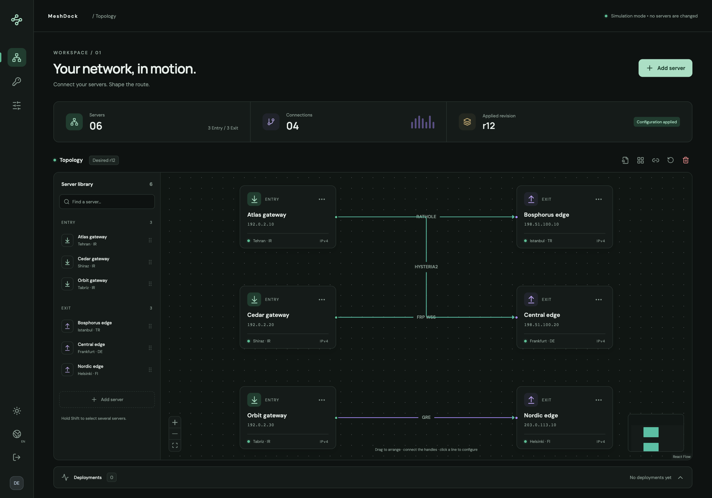
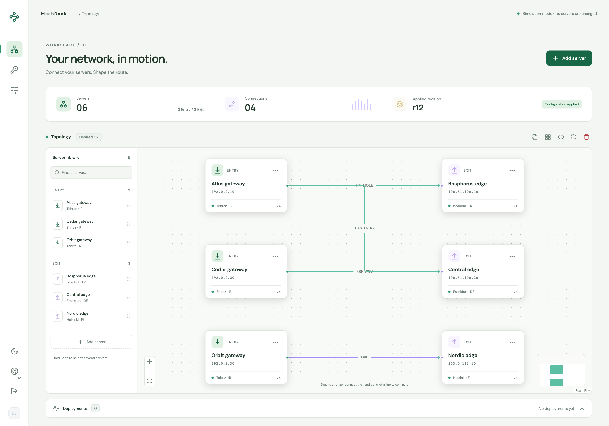
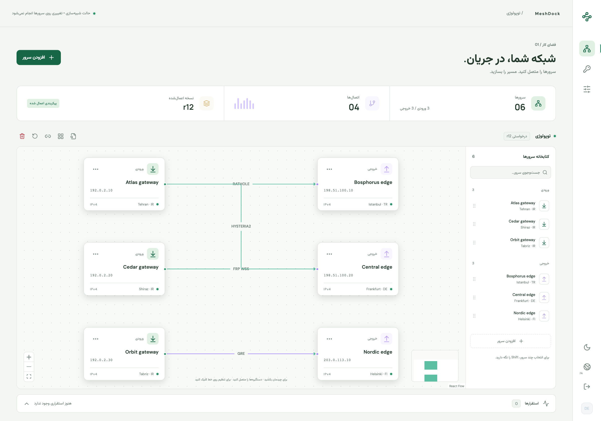
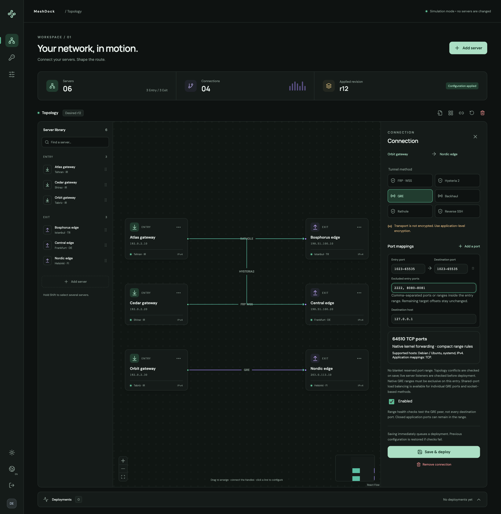
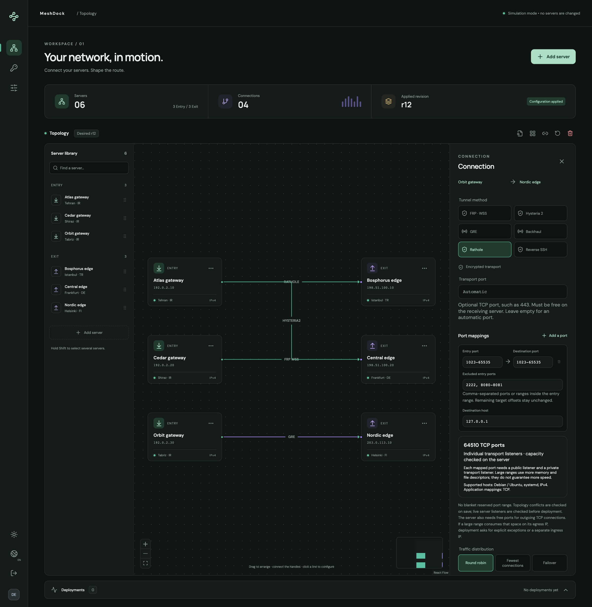

<div align="center">

# MeshDock

### Your network. Every connection.

A self-hosted workspace for building and managing server-to-server tunnels.
Draw connections, choose a transport, and follow deployments from one visual dashboard.

**6 tunnel methods · English & فارسی · Light & dark mode · MIT licensed**

[Quick start](#quick-start) · [What MeshDock manages](#what-meshdock-installs-and-manages) · [Screenshots](#screenshots) · [Your first tunnel](#your-first-tunnel) · [Deploy](#deploy-with-https) · [Documentation](#documentation)

</div>



MeshDock brings your server inventory, tunnel configuration, SSH credentials, and deployment history into one place. Use it to connect multiple entry servers to multiple destination servers, change transports, and manage port mappings without maintaining each configuration by hand.

> **Project status:** MeshDock is under active development. It has automated application and isolated network tests, but has not been deployed in production or validated against live filtering conditions. Try the demo first, then test on disposable servers before relying on it.

## What you can do

- **Build your topology visually.** Drag server cards, connect their handles, reconnect lines, or select several servers to create connections in a batch.
- **Switch tunnel methods.** Choose GRE, Backhaul, Rathole, reverse SSH, FRP WSS, or Hysteria 2. Mappings are validated when you change methods.
- **Forward individual ports or ranges.** Use ranges such as `1023-65535` with explicit exceptions. MeshDock checks management ports, transport listeners, overlapping mappings, and live server conflicts.
- **Reuse SSH credentials.** Store root passwords or private keys in an encrypted vault, then use them across servers. Verify and pin each server's SSH fingerprint.
- **Follow deployments.** See persisted deployment events, retry failures, and recover the previous configuration when activation fails.
- **Automate through the API.** Administrators sign in with a username and password; integrations use scoped Bearer API keys.
- **Work in your language and theme.** English and Persian, full RTL layout, and light and dark appearances are included.

## What MeshDock installs and manages

**MeshDock installs and configures the tunnel infrastructure, including its own server-side firewall and forwarding rules.** You do not need to install or configure Backhaul, Rathole, FRP, Hysteria, or GRE tunnels before adding your servers. You can start with fresh supported servers that already have working root SSH access.

In **real mode**, saving a connection queues a deployment. MeshDock connects over SSH, prepares the required software and configuration, starts its managed services, and checks the result. In **demo mode**, these actions are simulated.

| Component | MeshDock's responsibility |
| --- | --- |
| **Tunnel software** | Downloads and verifies required Backhaul, Rathole, FRP, or Hysteria binaries for the selected method. Installs supporting packages, including OpenSSH tools for reverse SSH. |
| **GRE** | Uses Linux's GRE support to create and configure tunnel interfaces, addresses, MTU, and the forwarding setup. GRE is a kernel feature, rather than a separate downloaded tunnel program. |
| **Dependencies and helper** | Installs required system packages and a small remote helper. Configures its own HAProxy services where the selected mapping needs proxy listeners or traffic distribution. |
| **Server-side networking** | Adds and manages its own firewall chains and rules inside the servers. Configures listeners, port forwarding, and NAT/forwarding rules where the method requires them. |
| **Service lifecycle** | Creates and starts managed systemd services, applies connection and method changes, records deployment events, checks activation, and attempts rollback if deployment fails. |
| **Cleanup** | Removes its managed tunnel services, interfaces, and firewall rules when requested. Shared packages and recovery files are retained; see [full removal](docs/OPERATIONS.md#cleanup-and-full-removal). |

### What you prepare yourself

- **Servers and access:** provide supported Debian/Ubuntu servers with systemd, root SSH credentials, and management connectivity from the controller. Verify their SSH fingerprints. The servers also need access to package repositories and the selected software's download sources during installation.
- **The destination application:** install and configure the application that receives the forwarded traffic, such as **Xray managed by 3x-ui**, a web server, or another TCP service. Tell MeshDock its destination host and port. MeshDock handles the tunnel; your application handles its users, authentication, and application-level routing.
- **Network controls outside the servers:** allow the chosen transport and required application traffic through your provider's firewall/security groups. Arrange any required NAT or port forwarding on an upstream router. MeshDock currently has no integration for changing those external controls.

**Server firewall rules and provider firewall rules are different layers.** MeshDock changes its own rules inside the managed Linux servers. A hosting provider's security group can still block packets before they reach those rules.

For example, if Xray already listens on port `8443` on your Turkey server, you can map port `443` on your Iran server to it:

```text
VPN client → Iran:443 → MeshDock-managed tunnel → Turkey's Xray service:8443
```

MeshDock sets up and operates the tunnel and forwarding between those servers. You maintain Xray/3x-ui and its client accounts. Existing Xray routing, unrelated Nginx sites, management SSH daemon settings, and default routes stay under your control while MeshDock adds the resources it owns.

## Quick start

### Try the demo with Docker

You need **Docker with Compose v2** and **Python 3** for the configuration generator. Download or clone this repository, open a terminal in its root directory, then run:

```sh
python3 scripts/setup.py --demo
docker compose -p meshdock-demo up --build -d
```

1. Open **[localhost:8080](http://localhost:8080)** on the machine running Docker.
2. Sign in as **`admin`**. Find your generated password in `.env`, under `MESHDOCK_ADMIN_PASSWORD`.
3. Choose **Explore a sample network**, then try moving servers, connecting them, and changing methods.

**Demo mode simulates deployments. It never opens SSH connections or changes your servers.** The `.env` generator creates a unique password and refuses to overwrite existing configuration.

Stop the demo while retaining its data:

```sh
docker compose -p meshdock-demo down
```

The `meshdock-demo` project name gives the demo its own Docker volumes. Keep using that name for its lifecycle commands. To deploy a real instance later, use a fresh checkout, new configuration, and a separate data volume; do not switch a demo database into production mode.

<details>
<summary>Running the demo on a remote machine?</summary>

The demo web port is bound to loopback. Forward it over SSH from your computer:

```sh
ssh -N -L 8080:127.0.0.1:8080 user@controller.example.com
```

Replace the example host and username, then open [localhost:8080](http://localhost:8080) on your computer. For regular remote access, use the HTTPS deployment below.

</details>

### Run locally for development

You need **Python 3.12+, uv, Node.js 22+, and npm**.

```sh
./scripts/dev.sh
```

Open **[127.0.0.1:5177](http://127.0.0.1:5177)**. The API runs at `http://127.0.0.1:8017`. The launcher installs dependencies and generates `.env` if needed; use its generated admin password to sign in.

The launcher **always defaults to demo mode**, even if `.env` or your shell sets `MESHDOCK_DEMO=false`. Real server changes require the explicit flag:

```sh
./scripts/dev.sh --prod
```

`--prod` enables real deployments while running the local development servers. Use Docker for hosting the service. Stop the current launcher before changing modes. Demo and real mode keep separate databases and encryption keys in `.data/demo` and `.data/prod`; the launcher sets these locations itself.

## Screenshots

These are captures of the actual UI using fictional servers and reserved documentation addresses. No production hosts, credentials, or personal data appear in them. Click an image to inspect the full-size version.

| Light appearance | Persian and RTL |
| --- | --- |
| [](docs/screenshots/dashboard-light.png) | [](docs/screenshots/dashboard-persian.png) |

<details>
<summary><strong>Explore the connection editor: methods, port ranges, and exceptions</strong></summary>

Select a connection to choose its tunnel method and map ports. Here, `1023-65535` excludes `2222` and `8080-8081`, leaving 64,510 mapped TCP ports.



Switching to a socket-based transport retains the mapping and displays its resource requirements. Accepting a range does not guarantee that a particular server has enough capacity to run it.



</details>

## Your first tunnel

There are three roles to understand:

| Role | What it does |
| --- | --- |
| **Controller** | Runs MeshDock and uses SSH to configure your servers. |
| **Entry server** | Accepts your users' application connections. |
| **Exit server** | Reaches the destination service, such as an existing proxy or web service. |

For example, users can connect to an entry server in Iran while an exit server in Turkey forwards those connections to your application. MeshDock installs and manages the tunnel between them; prepare the destination application as explained in [What MeshDock installs and manages](#what-meshdock-installs-and-manages).

1. **Save a credential.** Open **SSH vault** and add a root password or SSH private key. Private keys may have a passphrase and can be reused.
2. **Add your servers.** Choose **Add server**, set the entry/exit role, and select a saved credential. The SSH management address can differ from the public transport address. Compare the discovered fingerprint against your provider console or another trusted source before accepting it.
3. **Connect them.** Draw a line from an entry's right-hand handle to an exit's left-hand handle. Choose a method and set the entry port, destination port, and destination host. For a service running on the exit server, the destination host is usually `127.0.0.1`.
4. **Save and follow the deployment.** **Save & deploy** queues the change. MeshDock installs required tunnel packages, writes its managed configuration, starts services, and runs health checks. Open **Deployments** to follow progress.
5. **Test the actual application.** Connect a client through the entry server and verify traffic. An applied revision confirms deployment checks passed; it is not a continuous uptime or speed measurement.

Click a line to edit or switch its method. Drag an endpoint to change its destination. Hold **Shift** to select servers, then choose **Connect selected** for batch connections. Moving a card changes only the layout and does not deploy anything.

### Port ranges and multiple destinations

Map a single port (`443 → 8443`) or equal-width ranges (`8000-8099 → 9000-9099`). Exceptions refer to **entry ports** and preserve each remaining port's destination offset.

There is no blanket reserved port band. Exclude your actual conflicting management or service ports, or choose a different transport control port. GRE ranges use kernel forwarding. Other methods create listeners and are subject to descriptor limits, available ports, memory, and connection capacity.

For socket-based connections, a shared entry port can distribute traffic across several exits using **Round robin**, **Fewest connections**, or **Failover**. Native GRE ranges require exclusive entry intervals. See [port mapping behavior and limits](docs/PORT-MAPPINGS.md) before using broad ranges or shared ports.

## Supported tunnel methods

All current adapters forward **TCP application traffic**. The transport itself may use a different protocol.

| Method | Transport | Encryption | Main requirement |
| --- | --- | --- | --- |
| **GRE** | IP protocol 47 | No | GRE must be permitted between public IPv4 endpoints; supports compact kernel forwarding for ranges. |
| **Backhaul** | TCP | No | Exit can initiate TCP connections to entry; use application-level encryption. |
| **Rathole** | TCP with Noise | Yes | Exit can initiate TCP connections to entry. |
| **Reverse SSH** | SSH over TCP | Yes | Exit can reach the managed SSH listener on entry. |
| **FRP WSS** | WebSocket over TLS | Yes | Exit can reach entry over TCP; MeshDock uses pinned private TLS. |
| **Hysteria 2** | QUIC over UDP, with Salamander | Yes | Entry can reach exit over UDP. |

Use [transport research and limitations](docs/TRANSPORTS.md) for more detail. No method guarantees connectivity through every provider firewall or filtering system.

## Deploy with HTTPS

### Before you start

- **Controller:** Docker with Compose v2, Python 3 for setup, a domain pointing to this machine, and inbound ports **80 and 443** for Caddy.
- **Managed servers:** Debian or Ubuntu with **systemd**, root SSH access from the controller, and public IPv4 transport addresses.
- **Network:** Allow the selected transport and required application traffic in provider firewalls/security groups, and arrange any upstream-router NAT. MeshDock configures its own firewall and forwarding rules inside the servers. Management SSH must be reachable from the controller even if it is blocked between tunnel peers.
- **Destination application:** Have Xray/3x-ui, your web server, or another TCP application running at the destination host and port. You do not need to preinstall the tunnel software; MeshDock installs and configures that during deployment.

On a **fresh checkout with no `.env`**, replace the example domain and run:

```sh
python3 scripts/setup.py --origin https://meshdock.example.com
docker compose --profile tls up --build -d
```

Open your domain and sign in using the generated credentials in `.env`. Omitting `--demo` enables real deployments. Caddy obtains the TLS certificate; API and worker are not published directly. The web service also listens on controller loopback at port 8080 for use behind your own reverse proxy.

Keep **one API and one worker per SQLite database**, on a local Docker volume rather than NFS. Start with disposable servers and follow the [staging checklist](docs/OPERATIONS.md#first-staging-deployment).

### Configuration

Use the generator for a unique password. [sample.env](sample.env) documents manual configuration; `.env.example` contains the same template. Replace its placeholder password if configuring manually.

| Variable | Purpose |
| --- | --- |
| `MESHDOCK_ADMIN_USERNAME` | Initial administrator username; defaults to `admin`. |
| `MESHDOCK_ADMIN_PASSWORD` | Initial administrator password, at least 12 characters. |
| `MESHDOCK_PUBLIC_ORIGIN` | The full browser-facing origin, such as `https://meshdock.example.com`. |
| `MESHDOCK_DOMAIN` | Domain used by Caddy. |
| `MESHDOCK_COOKIE_SECURE` | Set to `true` for HTTPS deployments. |
| `MESHDOCK_DEMO` | `true` simulates deployments; `false` permits server changes. |
| `MESHDOCK_PORT` | Local web port in Docker; defaults to `8080`. |

The admin variables initialize a new database only. Change an existing password in **Access & activity**; editing `.env` does not reset it. Keep `.env`, private keys, database files, backups, and real infrastructure details out of Git.

## Operations and recovery

- **Watch the controller:** `docker compose logs --tail=100 -f api worker`. Use `-p meshdock-demo` when inspecting the isolated demo.
- **Back up both data and key:** preserve `meshdock.sqlite3` **and its matching `master.key`**. The database alone cannot recover encrypted credentials. Follow the [backup and restore guide](docs/OPERATIONS.md#backup-and-restore).
- **Upgrade deliberately:** back up, stop API and worker, and deploy the same release for both. Schema changes are tracked with Alembic and applied at startup. See [migrations](docs/MIGRATIONS.md).
- **Recover failed changes:** MeshDock retries bounded failures and attempts to restore the preceding generation. If rollback cannot reach a host, restore SSH access and choose **Retry rollback** before deploying again.
- **Remove managed resources:** **Clean up tunnels** disables links and removes owned services, interfaces, and firewall rules. Shared packages and recovery files remain; [full removal](docs/OPERATIONS.md#cleanup-and-full-removal) is a separate step.

Changes spanning several hosts are not a single atomic transaction. Switching methods can interrupt active connections. MeshDock installs and manages its own resources under `/var/lib/meshdock`, `meshdock-*` services, and dedicated firewall chains. Its networking changes are scoped to those tunnels; existing application configuration and management access remain under your control. See [What MeshDock installs and manages](#what-meshdock-installs-and-manages) for the responsibility split.

<details>
<summary><strong>Common questions</strong></summary>

**The setup command says configuration already exists.**

It intentionally preserves `.env`. Reuse it for the same instance. For a separate real deployment, use a fresh checkout and data volume instead of changing a demo instance's mode.

**My tunnel is applied, but my application does not connect.**

Check the destination host/port and application first, then transport reachability and provider firewall rules. Review the deployment events. Health checks do not exercise every application protocol or mapped port.

**Can MeshDock manage multiple entry servers and exits?**

Yes. Each connection is represented separately. Public listeners, transport ports, and pool policies still need to be compatible; the [mapping guide](docs/PORT-MAPPINGS.md) explains conflicts.

**Does the dashboard manage VPN users or install my proxy application?**

No. MeshDock manages server-to-server tunnels. Keep your destination application and client management in their existing tools.

**What is supported today?**

Linux targets with Debian/Ubuntu and systemd, IPv4 endpoints, and TCP application mappings. UDP application forwarding and IPv6 tunnel addressing are not currently implemented. Hysteria's UDP transport does not change that application-level limit.

</details>

## API access

Create a key in **Access & activity**, copy it when it is shown, and send it in the `Authorization: Bearer` header. Read-only keys inspect topology and jobs; write keys also save layout; admin keys can change infrastructure. Never put API keys in URLs.

After setting `MESHDOCK_URL` to your controller URL and `MESHDOCK_API_KEY` to your generated key:

```sh
curl --fail --silent --show-error \
  -H "Authorization: Bearer ${MESHDOCK_API_KEY}" \
  "${MESHDOCK_URL}/api/v1/topology"
```

Routes are versioned under `/api/v1`. The OpenAPI schema is at `/api/openapi.json`. See [architecture and extension contracts](docs/ARCHITECTURE.md) before building an adapter or integration.

## Contributing

MeshDock uses **FastAPI, SQLAlchemy 2, Alembic, and SQLite** in `backend/`, and **React, TanStack Query, React Flow, and i18next** in `frontend/`. Docker Compose runs the API, worker, web UI, and optional TLS proxy together.

Start with [AGENTS.md](AGENTS.md) for development conventions and [architecture](docs/ARCHITECTURE.md) for the adapter interface. Database changes require a new Alembic migration. UI strings belong in English/Persian JSON catalogs; backend messages use gettext `.po` files. Use fictional addresses and isolated fixtures for tests and screenshots.

<details>
<summary><strong>Run the checks</strong></summary>

From the repository root:

```sh
uv sync --project backend --frozen
uv run --project backend --no-sync python backend/compile_locales.py
(cd backend && uv run --no-sync pytest -q)
uv run --project backend --no-sync black --config backend/pyproject.toml --check backend scripts
uv run --project backend --no-sync ruff check --config backend/pyproject.toml backend scripts
(cd frontend && npm ci && npm run format:check && npm test && npm run build)
(cd frontend && npx playwright install chromium && npm run test:e2e)
```

Linux packet tests are opt-in and run in a disposable container with no external network. See [isolated network tests](docs/OPERATIONS.md#isolated-gre-packet-test). See [screenshot instructions](docs/screenshots/README.md) to refresh this gallery.

</details>

## Documentation

| Guide | What you will find |
| --- | --- |
| [Operations](docs/OPERATIONS.md) | Staging, ownership, logs, backup, recovery, and cleanup. |
| [Port mappings](docs/PORT-MAPPINGS.md) | Ranges, exceptions, conflicts, pools, and resource limits. |
| [Transports](docs/TRANSPORTS.md) | Method research, evidence, tradeoffs, and limitations. |
| [Architecture](docs/ARCHITECTURE.md) | Backend boundaries, API contracts, and adding adapters. |
| [Migrations](docs/MIGRATIONS.md) | Versioned database changes and upgrade guidance. |
| [Verification](docs/VERIFICATION.md) | What has been tested and what remains unverified. |
| [Decisions](docs/DECISIONS.md) | Current scope and open design questions. |

## License

MeshDock is available under the [MIT License](LICENSE).
